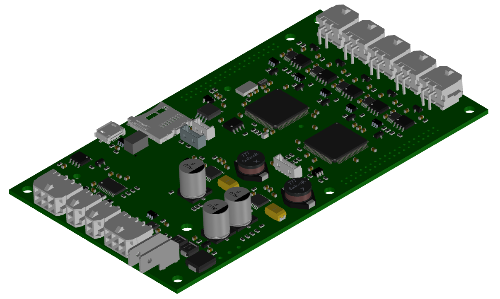

USEA-Payload
============

| nke Instrumentation provides this application programming interface (API) for PROVOR-CTS5 float.\
| It enables third-party Python programming in USEA-Payload acquisition board.

**Objective**

* Develop new capabilities for profiling floats:
   - Integrate challenging sensors
   - Assessment of specific data processing
* Validate performance prior to industrial integration by nke

API modules
===========

.. toctree::
   :maxdepth: 2
   :caption: USEA-Payload API comes with the following system resources:

   modules

Indices and tables
==================

* :ref:`genindex`
* :ref:`modindex`

